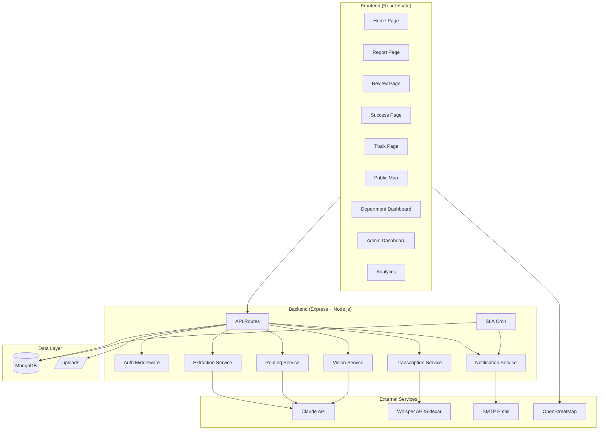

# Shonglap (সংলাপ) - Dhaka Civic Complaint Auto-Routing Portal

Shonglap is a comprehensive MERN-stack portal designed for Dhaka, Bangladesh, enabling citizens to report civic problems (via text, photo, or Bangla voice note) with automated multi-stage routing, Zod validation, and departmental dashboards.

## Architecture



## Monorepo Structure

- `/server`: Node.js Express backend with MongoDB (Mongoose), Zod validation, Whisper transcription adapters, Claude LLM integration, and comprehensive tests.
- `/client`: React + Vite + Tailwind frontend with React Router, react-i18next (Bangla/English), react-leaflet maps, and Noto Sans Bengali font.
- `/data`: Seed JSON files for departments and jurisdictions.
- `/whisper-sidecar`: Python FastAPI service using faster-whisper for transcription.

## Getting Started

### Prerequisites

- Node.js 20+
- MongoDB (local or Atlas)

### Environment Setup

1. Copy `.env.example` to `.env` in the root and `/server/.env`.
2. Configure your MongoDB URI and API keys.

### Running with Docker Compose

```bash
docker-compose up --build
```

### Running Locally

#### Server

```bash
cd server
npm install
npm run dev
```

To run tests:
```bash
npm test
```

To seed the database:
```bash
npm run seed
```

To evaluate routing:
```bash
npm run eval:routing
```

#### Client

```bash
cd client
npm install
npm run dev
```

## Module Documentation

### `server/src/services/llm.js`
Shared Claude client wrapper. Exports `callClaudeJson({system, messages, schema, mockFn})` which all LLM-dependent services reuse. Handles MOCK_LLM mode, JSON parsing, Zod validation, and one retry on failure. Strips markdown code fences from LLM output.

### `server/src/services/extraction.js`
Extracts structured complaint data from raw text and image descriptions. Exports `extractComplaint({text, imageDescriptions})` returning an `ExtractedComplaint` validated by Zod. Uses a system prompt with category list and urgency rubric (open manhole, live wire, gas leak = critical). MOCK_LLM mode returns deterministic keyword-based output. Missing fields computed post-extraction (area required, landmark optional).

### `server/src/services/routing.js`
Hybrid routing engine. Exports `routeComplaint(extracted, location)` returning a `RoutingDecision` with primary/secondary department IDs, confidence, method (rule/llm/triage), reasoning, and needsTriage flag. Pipeline: keyword rule layer -> jurisdiction resolution (DNCC/DSCC, DPDC/DESCO) -> LLM classifier (when ambiguous) -> multi-department rules (waterlogging -> WASA + city corp) -> triage (confidence < 0.7 or spam).

### `server/src/services/transcription/`
Multi-provider transcription service. `index.js` exports `transcribeAudio(filePath, {language})` and picks a provider from `TRANSCRIBE_PROVIDER`: openai.js (OpenAI Whisper API), whispercpp.js (whisper.cpp binary), sidecar.js (POST to sidecar URL).

### `server/src/services/vision.js`
Photo analysis service. `analyzePhoto(filePath, {text})` returns `{description, detectedIssue, suggestedCategory, severity, isRelevant, exifLat, exifLng, qualityWarning, conflict}`. Validates type (jpg/png/webp) and size (<8MB), reads EXIF GPS with exifr, resizes with sharp, sends to Claude vision.

### `server/src/services/notification.js`
Basic notification service for department and citizen notifications. Logs in test/mock mode.

### `server/src/utils/audio.js`
Audio preprocessing: converts any format to 16kHz mono WAV via fluent-ffmpeg. Enforces 2-minute and 10MB limits. Cleans up temp files.

### `server/src/utils/spam.js`
Basic spam detection for complaint text.

### `server/src/middleware/validate.js`
Zod request validation middleware factory.

### `server/src/models/`
Mongoose models: Complaint, Department, Jurisdiction, User, Draft (TTL 1h), RoutingCorrection.

### `server/src/config/`
- `env.js`: Zod-based environment validation on startup.
- `db.js`: MongoDB connection helper.

### `server/src/utils/`
- `logger.js`: Pino logger (silent in test mode).

### `server/src/routes/`
- `complaints.js`: Draft, answer, submit, track endpoints.
- `transcribe.js`: POST /api/transcribe
- `analyze-photo.js`: POST /api/analyze-photo

### `server/scripts/`
- `seed.js`: Seeds departments and jurisdictions from /data JSON.
- `evalRouting.js`: Evaluates routing accuracy on sample complaints.

### `whisper-sidecar/`
Python FastAPI service using faster-whisper (model large-v3, auto device). Endpoint POST /transcribe with Dhaka terms initial_prompt. Includes requirements.txt and Dockerfile.
