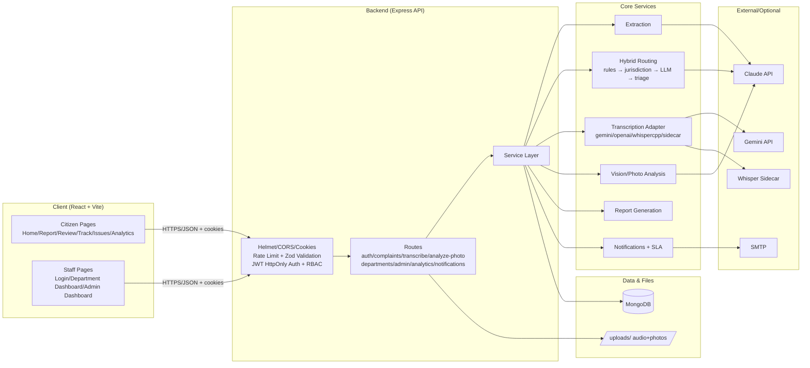

# Shonglap (সংলাপ)

Shonglap is a MERN civic complaint portal for Dhaka, Bangladesh. Citizens can report issues via text, voice, or photo in Bangla/English/Banglish. The system extracts structured complaint data, routes complaints with a hybrid rules + LLM pipeline, and provides staff dashboards, tracking, notifications, and formal report generation.

## Current Highlights

- **Citizen reporting**: text, voice note, photo upload, category/area selection, optional contact info, anonymous submission allowed.
- **Voice transcription**: provider adapters for `gemini`, `openai`, `whispercpp`, and `sidecar`. Gemini path includes timeout/retry and skips WAV conversion for lower latency.
- **Hybrid routing**: rule layer → jurisdiction resolution → LLM classifier (when needed) → multi-department rules → triage fallback. Low-confidence/ambiguous cases go to triage.
- **Zod validation**: API body/query/params are validated with descriptive 400 errors.
- **Auth/security**: JWT auth stored in secure `HttpOnly` cookie (`Secure` in production, `SameSite=Lax`), CORS credentials enabled, cookie-auth CSRF origin guard, login rate limiting, role-based access, strict department isolation.
- **Password storage**: scrypt hash with explicit per-user salt; legacy bcrypt hashes are still verified for compatibility.
- **DB safety**: Mongoose queries use explicit field selection/projections.
- **Dashboards**: department dashboard, admin triage/assignment/reroute, analytics, issues list, complaint tracking, notifications.
- **Reports**: JSON + minimal formal report endpoint; `area` is the required field for formal report generation.
- **Cross-department complaints**: a single voice/text statement is automatically split into distinct problems; each problem is classified and routed to its owning office. Each office receives a scoped `departmentPart` (category, description, reason, independent status) and sees only its own part — no manual department selection.
- **Landmark-based location**: a curated Dhaka landmark gazetteer (`data/landmarks.json`, bus stops/shops/landmarks with Bangla/Banglish aliases and fuzzy ASR matching) resolves the area when the citizen names a place instead of an area. Each problem uses its own landmark, and the review page asks the citizen to confirm or correct the inferred area.

## Tech Stack

| Layer | Tech |
|---|---|
| Frontend | React 19, Vite 8, Tailwind CSS 4, React Router, react-i18next, Leaflet/Recharts, Axios |
| Backend | Node.js 20+, Express 4, Mongoose 8, Zod, JWT, cookie-parser, bcrypt/scrypt, multer, ffmpeg, pino, helmet, cors, rate-limit |
| AI/Media | Gemini/OpenAI Whisper/whisper.cpp/sidecar transcription, Anthropic Claude via `@anthropic-ai/sdk`, sharp/exifr |
| Data | MongoDB 7 (Docker bind mount) |
| Testing | Jest, Supertest, mongodb-memory-server, Playwright |

## Architecture



### Request/Processing Flow

1. **Citizen submits report**: client sends text/voice/photo/area. API validates input, stores media, transcribes audio (provider adapter), extracts structured fields, runs hybrid routing, and saves draft/complaint.
2. **Routing decision**: rule-based keywords and jurisdiction resolve obvious cases; ambiguous cases can use LLM; low confidence/spam goes to triage. Department assignment is stored with status log.
3. **Staff operations**: authenticated staff access role-scoped APIs. Department users only see/update their own complaints; admins triage/assign/reroute.
4. **Tracking & outputs**: citizens track by tracking ID, receive status updates/notifications, and can generate JSON/formal report output.

## Project Structure

```text
Shonglap/
├── client/                 # React + Vite frontend
├── server/                 # Express API, services, models, tests
├── data/                   # Seed JSON (departments, jurisdictions, samples)
├── docker-data/mongodb/    # Local MongoDB bind-mount data (gitignored)
├── docs/                   # Local setup and project docs
├── tests/e2e/              # Playwright E2E tests
├── whisper-sidecar/        # Optional FastAPI/faster-whisper sidecar
├── docker-compose.yml      # MongoDB service (persistent bind mount)
├── .env.example
└── README.md
```

## Setup

### Prerequisites

- Node.js 20+
- Docker Desktop (recommended for local MongoDB)
- ffmpeg (for non-Gemini audio conversion paths)

### Environment

1. Copy `.env.example` to `.env` (root) and/or `server/.env` as needed by your workflow.
2. Set required values:

```env
PORT=5000
NODE_ENV=development
MONGODB_URI=mongodb://localhost:27017/shonglap
JWT_SECRET=replace-with-a-long-random-secret
CORS_ORIGIN=http://localhost:5173

TRANSCRIBE_PROVIDER=gemini
GEMINI_API_KEY=your-gemini-key
GEMINI_MODEL=gemini-flash-lite-latest
MOCK_TRANSCRIPTION=false

ANTHROPIC_API_KEY=your-anthropic-key
ANTHROPIC_MODEL=claude-3-5-sonnet-20241022
MOCK_LLM=true
```

> For tests, use mock flags. Do not commit real secrets.

## Run Locally

### 1) Start MongoDB (persistent)

```bash
docker compose up -d
```

MongoDB data persists in `./docker-data/mongodb` via bind mount.

### 2) Start backend

```bash
cd server
npm install
npm run seed        # optional: seed base data
npm run seed:demo   # optional: demo data/users
npm run dev
```

### 3) Start frontend

```bash
cd client
npm install
npm run dev
```

- API: `http://localhost:5000`
- Client: `http://localhost:5173`

## Demo Accounts

After `npm run seed:demo` in `server/`:

| Role | Email | Password |
|---|---|---|
| Admin | `admin@shonglap.gov.bd` | `admin123` |
| DNCC | `dncc@shonglap.gov.bd` | `dept123` |
| DSCC | `dscc@shonglap.gov.bd` | `dept123` |
| WASA | `wasa@shonglap.gov.bd` | `dept123` |

## Scripts

### Root

```bash
npm run server:dev
npm run server:test
npm run client:dev
npm run client:build
```

### Server

```bash
npm run dev
npm run start
npm run seed
npm run seed:demo
npm run eval:routing
npm run eval:transcription
npm test
```

## Testing

```bash
# Backend (Jest + Supertest + mongodb-memory-server)
cd server
npm test

# E2E (Playwright, from repo root; expects app running)
npx playwright test
```

Current backend baseline: **16 suites, 96 tests passing** (mocked LLM/transcription in test env).

## Key API Areas

- `POST /api/auth/login`, `POST /api/auth/logout`, `GET /api/auth/me`
- `POST /api/complaints/draft`, `POST /api/complaints/draft/:id/answer`, `POST /api/complaints/submit`
- `GET /api/complaints/track/:trackingId`, `GET /api/complaints/:trackingId/report`
- `GET /api/complaints/search`, `GET /api/complaints/map`
- `POST /api/transcribe`, `POST /api/analyze-photo`
- `GET /api/departments/complaints`, `PATCH /api/departments/complaints/:id/status`
- `GET /api/admin/triage`, admin assign/reroute endpoints
- `GET /api/analytics/*`, `GET/POST /api/notifications/*`

All request body/query/params inputs are validated; invalid input returns descriptive `400` errors.

## Security Notes

- JWT is stored in an `HttpOnly` cookie; browser client does not store token in `localStorage`.
- CORS uses explicit origin with credentials.
- Cookie-auth mutating requests include a basic origin guard.
- Passwords use scrypt with explicit per-user salt; bcrypt legacy verification supported.
- Department users are scoped to their own department data.
- Uploaded files are served from `/uploads` (review access control before public production deployment).

## Docs

- To teach the router a new known place, add an entry to `data/landmarks.json` with `name`, `aliases` (Bangla/Banglish/English, including spelling variants), `area`, `lat`, `lng`, and `type`. The resolver reloads it on server start.
- `docs/LOCAL_MONGODB.md` - persistent local MongoDB setup
- `docs/DEPLOYMENT.md`, `docs/DEMO_SCRIPT.md` - deployment/demo materials
- `eval_report.md` - routing evaluation output
